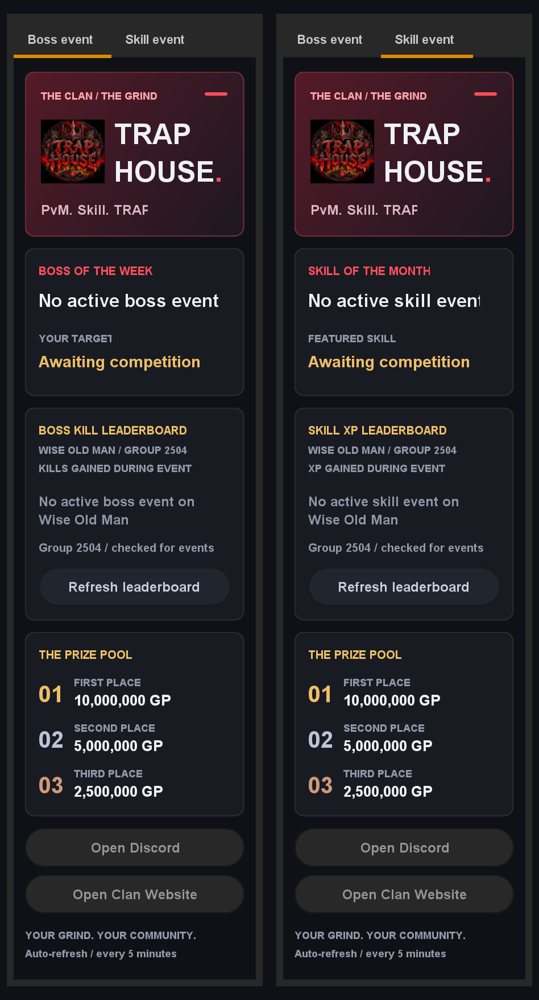

# Trap House Clan Plugin

A RuneLite sidebar for the **TRAP HOUSE** Old School RuneScape clan. Follow Boss of the Week and Skill of the Month competitions from [Wise Old Man group 2504](https://wiseoldman.net/groups/2504), with event leaderboards and fixed prizes.

The sidebar also includes **Profile**, **Ranks**, and **Leaderboard** tabs for an original clan ranking system. View server-calculated points, eligible rank, progress, point sources and recent awards; request manual rewards for administrator review. Existing Boss/Skill events and overlays remain available. Promotions and all in-game actions remain manual.

The ranking service is a separate PostgreSQL-backed deployment; see [server setup and API](server/README.md). Ranking sync is off by default. To connect, clan staff deploy an HTTPS API, configure scoring rules/thresholds, verify members and issue individual member credentials. In plugin settings, enable ranking sync and enter the API origin and your member token. No awards are enabled until staff configure rules.

The [reference review and staged plan](docs/reval-reference-review.md) records which Reval features have source implementations, which are explicit TODOs and which depend on unavailable backend code. The downloaded reference was inspected read-only; this system uses original TRAP HOUSE code.

The expanded clan dashboard includes **Achievements**, **Events**, **Diary**, and **Competitions**, with point breakdowns, read-only milestone/combat-tier probes, searchable member profiles, event registration, and race standings. See [feature configuration and limits](docs/clan-features.md). Preview the branded screens with `.\gradlew.bat previewClan`; fixture data is explicitly labelled and never appears in the production plugin.

## Features

- **Boss event:** Boss of the Week details and the top ten participants ranked by kills gained during the competition.
- **Skill event:** Skill of the Month details and the top ten participants ranked by XP gained during the competition.
- Automatic detection of active clan competitions, with separate competition-ID overrides for each tab.
- Event titles, featured bosses or skills, competition dates, and gold, silver, and bronze ranks.
- Automatic refresh every five minutes and a manual **Refresh leaderboard** button.
- Private boss and skill event announcements once per login, without repeating on world hops.
- On-screen event overlay showing both targets and time remaining, enabled by default with a settings toggle to turn it off.
- Separate boss and skill overlay toggles, with an optional top-three leaderboard for each event.
- Your recorded event rank, kills or XP gained, and gap to the player above you in each sidebar tab.
- Direct Wise Old Man competition links on both event tabs.
- Private event ending reminders and new event alerts while playing.
- Fixed first-, second-, and third-place prizes of 10M, 5M, and 2.5M GP for both events.
- TRAP HOUSE branding, an **Open Clan Website** button linking to https://traphouseosrs.net/, and an **Open Discord** button linking to https://discord.gg/thosrs.



## Build and run

Use **JDK 17 or newer** to run the included Gradle wrapper. The plugin compiles for Java 11. An internet connection is required to download dependencies and read Wise Old Man events.

On Windows, build and run the tests:

```powershell
.\gradlew.bat build
```

Launch a development RuneLite client with the plugin loaded:

```powershell
.\gradlew.bat run
```

On macOS or Linux, use `./gradlew` instead of `.\gradlew.bat`.

In RuneLite, enable **Trap House Clan Plugin** in plugin settings, then click the TRAP HOUSE sidebar icon. Building a JAR does not install the plugin into your regular RuneLite client.

### IntelliJ IDEA

1. Open the project as a Gradle project.
2. Select your installed JDK as the Gradle JVM and reload Gradle.
3. Run the Gradle `run` task, or run `TrapHousePluginLauncher.main()` from `src/test/java/com/traphouse`.

Restart the development client after changing plugin code.

### Jagex Account login in the development client

The development client supports Jagex Accounts through its **Jagex auth** sidebar panel. Run `gradlew.bat run`, open that panel, click **Add Jagex Account**, and complete the official Jagex login window yourself. Select your character (for example, Atazoth), then click **Play Now**. See RuneLite's [Jagex Account development instructions](https://github.com/runelite/runelite/wiki/Using-Jagex-Accounts). Do not copy session credentials into scripts or share passwords, codes, or ranking tokens.

The ranking API setting defaults to `https://trap-house-ranking-api.onrender.com`; an existing saved URL still takes precedence. Ranking sync remains an explicit opt-in and requires your own member token.

Members can also use **Sign in with Discord** to obtain that credential automatically after leadership verifies and links their character once. See [Discord sign-in setup](docs/discord-sign-in.md). Discord authentication does not replace Jagex login and never grants clan permissions.

The backend deployment seeds [150 tracking goals and the Owner-selected higher rank intervals](docs/milestones.md), preserving existing points, earned ranks, and configured rewards.

[Automatic drop and pet rules](docs/automatic-drops-and-pets.md) cover 118 named drop items and 55 new pet collection unlocks. Raid drops require the updated plugin and RuneLite Loot Tracker; pet unlocks require collection-log chat notifications.

[Discord linking requests and Owner approval](docs/discord-joining.md) let members request their character link with a Discord button or `/link`, and the Owner approve in Discord after verification. One-time bot/application configuration is required; existing Discord sign-in remains available.

The [WOM efficiency importer](docs/efficiency-rewards.md) displays EHP/EHB and awards 10 points per new EHP or EHB after a saved baseline, sharing a 250-point weekly cap. See the [current reward balance](docs/reward-balance.md) for drop, pet, event, diary, and shared-cap defaults; existing points and rank thresholds are preserved.

## Settings

| Setting | Purpose |
| --- | --- |
| Wise Old Man competition ID | Boss event override. Leave at `0` to detect an active boss competition automatically. |
| Skill of the Month competition ID | Skill event override. Leave at `0` to detect an active single-skill competition automatically. |
| Announce events on login | Show both events privately in game chat once per login. Enabled by default. |
| Show event overlay | Show boss and skill targets and time remaining on screen. Enabled by default; turn this off to hide the overlay. |
| Boss event in overlay | Include the boss event in the overlay. Enabled by default. |
| Skill event in overlay | Include the skill event in the overlay. Enabled by default. |
| Top three in overlay | Include the top three participants and their recorded scores. Disabled by default. |
| Event ending reminders | Private chat reminders within one day and one hour of an event ending. Enabled by default. |
| New event alerts | Private chat alerts when a new active event is detected during play. Enabled by default; applies to automatic event selection. |

A competition's ID is the number in its Wise Old Man URL, such as `154611` in `https://wiseoldman.net/competitions/154611`. Overrides must belong to **Trap House group 2504** and match the tab's event type. Historical and upcoming competitions are labeled accordingly.

## How tracking works

The plugin reads public competition data from Wise Old Man. Leaderboard scores are **gains recorded during the selected competition**, rather than lifetime kill counts, lifetime XP, or nearby NPC deaths.

Each tab selects an event whose start time has passed and whose end time has not passed. If several matching events overlap, it selects the most recently started one. The skill tab accepts individual skills and excludes overall-XP competitions.

If no matching event is running, the tab displays **No active boss event** or **No active skill event**. It does not substitute a finished event. Participants with missing hiscores baselines are omitted.

Members must update their Wise Old Man profiles for newer gains to appear. This plugin reads the recorded scores; it does not submit player updates or create competitions. Prizes are displayed as fixed amounts; the plugin does not distribute rewards.

Your progress uses your logged-in character's name locally to find your recorded score, including ranks outside the top ten. Equal scores use the leaderboard's alphabetical ordering. Progress and overlay leaderboards refresh with Wise Old Man data every five minutes. New event detection follows the same refresh interval. Ending reminders appear once per threshold while the plugin remains enabled; logging in during the final hour produces only the hour reminder. No player name is sent to Wise Old Man.

XP scores are abbreviated in the sidebar. Hover a leaderboard row to see the exact gain. Event dates are shown in UTC. Manual refreshes are limited to once every 30 seconds. If a refresh fails, the last fetched scores remain visible with a stale-data message.

## Preview the sidebar

Render the layout without starting a game client:

```powershell
.\gradlew.bat preview
```

Preview the current boss event:

```powershell
.\gradlew.bat preview --args=--live
```

Preview the current skill event:

```powershell
.\gradlew.bat preview --args=--skill-live
```

Preview a specific competition:

```powershell
.\gradlew.bat preview --args="--live 154611"
.\gradlew.bat preview --args="--skill-live 150717"
```

These commands write `build/trap-house-preview.png`. To render both tabs side by side with current Wise Old Man data:

```powershell
.\gradlew.bat previewBoth
```

The combined image is saved as `build/trap-house-both-tabs.png`. Live previews require an internet connection. The README screenshot shows the layout at the time it was captured, not current event status.

## Troubleshooting

- **No active event:** Check whether group 2504 has a running competition of the correct type. Use the appropriate competition-ID setting to view a specific event.
- **Scores look outdated:** Update the participant's Wise Old Man profile, then refresh the leaderboard.
- **Wrong competition type or group:** Choose a Trap House boss competition for Boss event, or a Trap House single-skill competition for Skill event.
- **Java cannot be found:** Set `JAVA_HOME` to your JDK installation, or configure the Gradle JVM in IntelliJ.

## Privacy

The Wise Old Man integration makes HTTPS read requests to `api.wiseoldman.net` for public competitions and participant scores; it does not send your player name to Wise Old Man.

**Optional ranking sync** sends your logged-in character name, event UUID/time, supported NPC loot item/source IDs or combat/collection unlock names, and configured progress observations (such as milestone items, quest/skill state and combat-tier completion) to your configured HTTPS clan API, authenticated by your member token. Only a logged-in TRAP HOUSE clan member is tracked. Manual reward requests send your reason; event registration sends the selected event ID. Do not include private information in reward reasons. Other authenticated clan members can browse shared points and achievement progress; private manual request details are excluded. The service maintains a verified roster, award history and approval audit and may send award notifications to Discord. The backend imports public EHP/EHB by default, sending active roster names to Wise Old Man; staff can disable these imports with TRAP_WOM_STATS_ENABLED=false. Tokens are stored in local RuneLite configuration with masked display, not encrypted storage. No game login credentials, account hash, screenshots or player chat are collected. Disable ranking sync to stop tracking; pending memory-only data clears on logout, account/config change or shutdown. Already-submitted awards remain on the server; contact clan staff about data access/removal and retention.

## Development and distribution

Plugin entry point: `com.traphouse.TrapHouseClanPlugin`.

Run `build` to compile and execute the tests. Tests cover event selection, time boundaries, kill and XP gains, group validation, leaderboard states, tab layout, and packaged logo resources.

This repository is a development project. Plugin Hub distribution requires a separate submission and acceptance; consult the [RuneLite Plugin Hub instructions](https://github.com/runelite/plugin-hub/blob/master/README.md) before submitting.
